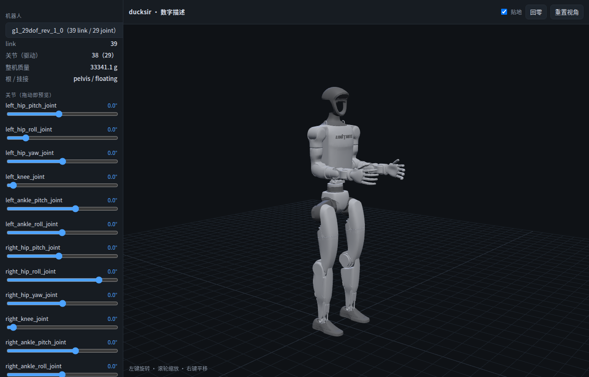

# client — ducksir 的 DSH 插件

三平面里的 **client**。装进 DSH 后，在这个 Web 界面上看状态、查策略、跑预检、发起训练。

## 硬边界

**客户端不进实时控制回路。** 端侧 50 Hz 的推理与安全层在 `runtime/`，客户端只是控制面：
它能读遥测、下指令、发起训练，但任何一条控制链都不许经过它。这条线写在 [README](../README.md) 第 0 节。

## 现在有什么

1. **只读工具 `ducksir_status`**：读仓库五个平面的落地情况、git 分支与脏文件数。
2. **机器人面板**：侧栏「机器人」→ 主区全屏面板，里面有**三个可切换的页面**（同一个 iframe，工具栏换 src）：

   | 页 | 文件 | 干什么 |
   |---|---|---|
   | 数字描述 | `viewer/index.html` | 拖关节 / 并联解算 / 轨迹回放（GLB + three.js FK） |
   | 浏览器跑 | `viewer/play.html` | MuJoCo wasm 物理 + 执行核 + ORT Web + **状态机**；`W/S` 调指令、`X/Z/C/V/B/R` 发策略指令（坐站/踢/翻滚/拾取/起身），也能手动切策略 |
   | 自算比对 | `viewer/live.html` | 浏览器算一遍 action，和宿主算的逐点比 |

   这三个页面都由 host 侧的只读静态路由 `/ducksir-static/*` 提供，只放 `client/viewer/` 和 `assets/` 两棵子树。
   **「浏览器跑」和「自算比对」需要先备素材**（都不入库）：
   `python3 tools/vendor_mujoco_web.py && python3 tools/vendor_ort_web.py` +
   `python3 sim/host/export_browser_check.py`，见 `docs/env.md` §8。

它是 Day-1 预检台的第一块砖，也是这个插件能否被加载、能否跑通的冒烟测试。

```
ducksir @ feat/client-plugin-skeleton · 6adc887 docs: ... · 脏 3
repo: /home/zqz/文档/deepseek-harness/default-workspace/projects/ducksir
契约     ✗ 空
硬件     ✗ 空
训练     ✗ 空
端侧     ✗ 空
客户端   ✓ 4 文件

缺 4 个平面：contract, hardware, training, runtime
```

## 装进本机 profile

这一步不是插件自己做的，是 profile 的事。三步，都在 profile 目录里：

```bash
cd ~/.dsh/profiles/web
```

1. `package.json` 的 `dependencies` 加一行（绝对路径）：

   ```json
   "ducksir-client": "link:/home/zqz/文档/deepseek-harness/default-workspace/projects/ducksir/client"
   ```

2. 同文件的 `dsh.profile.bundles` 数组里加一项 `"ducksir-client"`。

3. 装软链，并让热重载守护重新读一遍 link 列表（它启动时只读一次）：

   ```bash
   pnpm install
   systemctl --user restart dsh-autoreload
   ```

做完不用重启 `dsh web`：profile 重组会把插件挂上去。

**注意**：`~/.dsh/profiles/` 在 DSH 的文件沙箱之外，agent 改不了（会 `EACCES`）。这三步得人跑。

## 迭代循环

改 `client/**` → `dsh-autoreload` 2.5 秒内触发 profile 重组 → 工具立刻可用。
纯服务端代码不用重启进程；浏览器端 UI 代码才需要刷新页面。

只改 `package.json` **不会**触发重组，要手动追加一行注释或重启守护。

## 自检

```bash
node client/scripts/smoke.mjs
```

不需要装进 profile，假 ctx 跑一遍注册 / 执行 / 渲染。

## 面板这一半怎么工作

```
client/src/index.mjs   host：ducksir_status 工具 + /ducksir-static 只读路由（ctx.inject(['webServer']) 可选）
client/lib/client.js   web：侧栏「机器人」入口 + main 面板（iframe 指向 /ducksir-static/client/viewer/index.html）
```

- 为什么用 iframe 而不是把 three.js 打进宿主 bundle：查看器带 687 KB three + 22 MB GLB，
  塞进宿主既拖慢启动，又和宿主的 React 版本耦合。iframe 还让查看器能独立开发、独立截图回归。
- `client/lib/client.js` **是手写的**，不经打包器：面板只有一个 iframe，用 `React.createElement` 足够，
  省掉 esbuild 依赖。格式照 ModuleLoader 的 CJS factory 包（`window.__ModuleLoader__.load`）。
- 改 `client/src`（host）由 `dsh-autoreload` 触发热重组；改 `client/lib`（浏览器侧）要**刷新页面**。
- 坑：插件的 `inject` 里没声明 `webServer` 时，`ctx.webServer` 是 `undefined`，路由会**静默不注册**。
  用 `ctx.inject(['webServer'], (child) => …)` 起子 fiber，既让服务变成可选，也不吞错误。



## 未定

- **包名**：现在是 `ducksir-client`（私有）。要给别人装就得定 scope，晚改要动所有引用。
- **发布形态**：`link:` 只是本机开发用。正式分发要发 npm；`dsh-kit` 那套零依赖安装器 + doctor 可以复用。
- **UI 面板**：目前只有工具，没有面板。要做就照 `dsh-notes-editor` 的 client 编译方式（`lib/client.js` + 刷新页面生效）。

## 下一步

`contract/` 有内容之后，`ducksir_status` 应该从「数文件」升级成「核对契约」：
关节表能不能对上、obs/action schema 版本是否一致、policy manifest 缺哪些字段。
那才是真正的预检。
