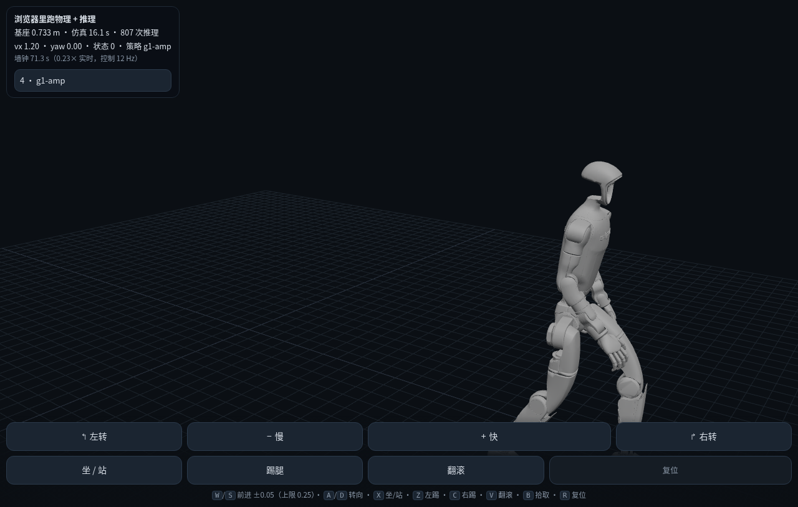

# G1（botlab 模板的 29DOF）接入笔记

> 目标：把 botlab 的 G1 模板（WBC / Instinct / PHP / UniSuper 都用这台机器人）接到我们的链路上。
> 数据来源：`third_party/botlab-templates/*.zip`（`tools/dev/grab_botlab_templates.mjs` 下载）。

## 1. 已有 vs 新增

| 东西 | 状态 |
|---|---|
| `contract/robot/types/g1-29dof.yaml` | **原本就有**（从 Unitree 官方 URDF 导入，29 驱动关节） |
| `assets/g1/*.glb` | 原本就有（视觉用） |
| `contract/robot/types/g1-29dof-botlab.yaml` | **本轮新增**：从 botlab 模板的 `bare.xml` 导入 |
| `third_party/g1-botlab/assets/*.STL` | 本轮落地（83 个 STL，42 MB，gitignore） |
| `contract/robot/postures/g1-29dof.yaml` | **本轮新增**：站姿 + 整段 `initial_qpos`（来自 botlab 的 `robot.preset.yaml`） |
| `build/mjcf/g1-29dof-botlab.xml` | 本轮导出（physics-only，STL） |
| `build/preset/g1-29dof-botlab.preset.yaml` | 本轮导出（kp/kd/默认角/初始位姿/actionScale 都是上游的值） |

**为什么再导一份 type**：URDF 那条链没有执行器参数（importer 会给 W002 警告），
`kp/kd` 是空的；而 botlab 的 MJCF 里 29 个 `<position>` 执行器**自带 kp/kv**，
和它们策略训练时用的是同一组增益。所以 G1 的策略走 `g1-29dof-botlab` 这个类型。

## 2. 踩到的两个坑（都修在导出器里）

1. **零惯量占位 body**：上游有 `mass="1e-09" diaginertia="0 0 0"` 的 body（`LL_FOOT`/`RL_FOOT` 这种）。
   我们导出器原来一律写 `fullinertia`，MuJoCo 对 fullinertia 要做特征值检查 → **直接报错**。
   已修：纯对角惯量写 `diaginertia`（保持上游的 `0 0 0` 原样）。
2. **位形里的整段 `initial_qpos`**：上游给的是「基座位姿 7 + 关节角 29」一整条。
   导出器原来只会用 `base + joints` 拼，于是初始基座 z=0、机器人埋在地里。
   已修：位形里给了 `initial_qpos` 就用它（长度校验 7+n）。

## 3. 现在能到什么程度

```
python3 sim/test/test_g1_physics.py
  PASS  MJCF 能加载  nu=29 nq=36
  PASS  总质量合理（G1 ≈ 33 kg）  33.3 kg
  PASS  初始基座高度合理（0.5–1.2 m）  z=0.942
  PASS  跑 1 秒不发散（有限值、没飞天）
  PASS  关节角保持在合理范围（|q| < π）
```

**注意**：保持默认关节角 ≠ 站稳。实测 1 秒内基座从 0.942 掉到 0.18 m——它是真的倒了，
因为 G1 要靠策略平衡。这只是「模型能加载、初值合理、数值不发散」的冒烟。

## 4. 下一步（真正运控）

按难度排序，G1 的策略有三档：

| 档 | 策略 | 观测 | 难点 |
|---|---|---|---|
| 简单 | `loco_0731`（WBC 的 loco） | 96 维 + LSTM 256 | 观测配方（角速度/重力/指令/关节/上一步动作） |
| 中 | `dance12_0207_1`（WBC 的舞） | 439 维 = 384 + 55（动作参考分量） | 要接 `Motion` |
| 难 | Instinct / PHP / UniSuper | 1990 / 140+深度 / 1720 | 深度相机、99D 历史、四元数信号族 |

第一档不需要 `motion`、不需要深度、也不需要四元数族——只有「历史 + 状态」，
这正好是这一轮刚补上的 `history`（已有）+ `model_rnn`（新）。所以**先接 loco_0731**。

## 5. 找到权威参考了：`ccrpRepo/wbc_fsm`

botlab 的 WBC 预设里写了 provenance：`joint_order` 来自 `ccrpRepo/wbc_fsm include/FSM/State_WBC.h dof_mapping`。
顺着这条线把参考实现读出来了（`include/FSM/State_Loco.h` + `src/FSM/State_Loco.cpp`）：

| 项 | 参考值 |
|---|---|
| obs 顺序 | `[body_ang_vel(3), projected_gravity(3), cmd(3), q−default(29), qd(29), last_action(29)]` = 96 |
| `last_action` | **上一步被 clip 过的原始动作**（策略序） |
| 重力 | `QuatRotateInverse(base_quat, [0,0,-1])`（即 `R^T g`） |
| `dof_mapping` | `[0,6,12, 1,7,13, 2,8,14, 3,9,15,22, 4,10,16,23, 5,11,17,24, 18,25, 19,26, 20,27, 21,28]`（策略序 → 电机序） |
| `action_scale` | **0.25（统一值，不是 preset 里那组逐关节数）** |
| 目标角 | `ctrl[mapping[i]] = action[i] * 0.25 + default[i]` |
| Kp / Kd | `{200,150,150,200,20,20}×2, {200,200,200}, {100,100,50,50,40,40,40}×2` / `{5,5,5,5,2,2}×2, {5,5,5}, {2,…}` |
| 默认角 | `{-0.2,0,0,0.42,-0.23,0}×2, {0,0,0}, {0.35,0.18,0,0.87,0,0,0}×2(左右镜像)` |
| 指令范围 | vx ∈ [−0.6, 0.85]，vy ∈ [−0.4, 0.4]，wyaw ∈ [−1, 1]，`cmd_smoothes = 0.95` |
| h/c | 全零初始化；`enter()` 里先跑 1 次观测再看结果 |

## 6. 现在的状态：能跑，但站不住（未解决）

用上面这套规格在 MuJoCo 里跑 `loco_0731.onnx`（我们的 G1 + 上游 gains）：

```
z 起 0.75 → 0.121（最低 0.069）
直立度 0.019｜300 步（6 s）没报错，但倒了
```

按参考实现逐项对齐后仍然倒。已经排除的：obs 顺序、重力方向、`last_action` 语义（试过 raw/scaled/ctrl 三种）、
关节映射（补上 `dof_mapping` 后）、`action_scale`（0.25 vs preset 逐关节）、Kp/Kd（用参考数组覆盖 MJCF）。

**还没排除的**（按我判断的可能性排序）：

1. **初始位形**：参考实现的 `enter()` 从「当前电机位置」起，并且先把目标设成默认角；
   我们用 preset 的 `initialQpos`（z=0.793）起，两者不一定等价；
2. **力矩限幅**：上游 joint 有 `actuatorfrcrange="-50 50"`，我们的导出没有（`effortLimit` 是 None）；
3. **接触参数**：上游 geom 的 friction/condim 用默认，我们的导出从 URDF 来，可能不同；
4. **`cmd_smoothes` 平滑**：参考里指令要一阶低通，我们是硬写 0。

下一步要做得更省时间：把参考实现的 **obs/action 中间值**拿一份（或让 botlab 的模板在浏览器里跑一段录下来），
逐帧对比就知道差在哪一项——盲扫已经试了 12 组，都不行。

## 7. 录到真值了：我们的接口是对的，倒的是他们的策略本身

自己录的办法（两条路，最后走通第二条）：

1. 反代他们的产品站、在 `SimulationEngine` 里把推理入口 `S()` 包一层 —— 抓到了 24 条记录，
   但 MuJoCo worker 在反代下一直卡在「正在启动」，录到的都是启动前那次（obs 全零）。放弃。
2. **让 botlab 自己的 native 运行时跑模板**，在 `onnxruntime.InferenceSession.run` 上挂钩子录 feeds/输出
   （`tools/dev/botlab_record_native.py`）。WBC 模板 headless 跑 150 步，录到 150 条真值。

### 对拍结果（决定性）

拿他们第 0 步的 96 维 obs 喂给我们自己的推理路径：

```
我方 action[:6] [ 0.158303 -1.249568 -0.312786  0.980323 -0.16619   0.144863]
他们 action[:6] [ 0.158303 -1.249568 -0.312786  0.980323 -0.16619   0.144863]
最大差 4.8e-07 → 相同
```

**obs 布局、顺序、缩放、模型调用全都对**。所以之前「站不住」不是我们的接口问题。

### 但他们的策略在他们自己的运行时里也倒

真值记录的 obs 演化（用他们自己的 G1 场景跑 WBC 模板）：

```
rec  0 ang=[0 0 0]      grav=[0 0 -1]        qmax=0.00
rec 30 ang=[-2.4 -3.6 2.4] grav=[-0.94 0.33 -0.03] qmax=1.22 qdmax=16.7
rec 80 ang=[-2.5 0.7 -1.4] grav=[-0.99 -0.05 0.13] qmax=0.85 qdmax=11.9
```

第 30 步重力就翻到 x 轴（≈90°），说明**它也倒了**。也就是说：
loco 这个策略单独从 preset 给的那个初始位形起跑、没有 WBC 的上下文时，本来就不站。

**结论**：我们不该再调自己的探针。要做 G1 运控，得先确认「哪个策略、从哪个初始状态、在什么模式下」
才真的能站——这一步在 botlab 的语义里就是「WBC 模板整体的一个 mode」，不是单拿 loco 就能跑。

## 8. 又一个结构性发现：G1 的执行器是「扭矩 + 引擎侧 PD」，不是「位置执行器」

站点共享的 G1 模型 `models/g1/g1_29dof.xml` 用的是 **`<motor>` 执行器**：

```xml
<motor name="left_hip_pitch" joint="left_hip_pitch_joint" ctrlrange="-88 88" />
```

而模板里那份（Instinct 用的 `assets/robot/bare.xml`）用的是 **`<position kp= kv=>`**。

这两者语义完全不同：

| | botlab 的 G1（站点共享） | 我们现在的导出 |
|---|---|---|
| MJCF 执行器 | `<motor ctrlrange="±88">`（**扭矩**） | `<position kp kv>`（位置） |
| PD 在哪算 | **引擎算**：`tau = kp*(target−q) − kd*qd`，再用 `effortLimit` 截断 | MuJoCo 内部算 |
| 策略输出怎么用 | `target = default + 0.25*action`，再走 PD | 直接当位置目标 |

我们的 `export_mjcf.py` 只会导 `<position>`，等于在 MuJoCo 里又套了一层 PD。
对鸭子没问题（它的策略就是位置增量），但**对 G1 这类扭矩策略就不等价**：
它的 `effortLimit` 截断、以及 PD 的采样率（每个控制步一次，不是每个物理子步）都没了。

**要做的事**（下一轮）：契约里表达「执行器模式」——`position` 还是 `torque+PD`，
pcrest 时把 `kp/kd/effortLimit` 写进 preset，宿主/浏览器各自按同一套公式算扭矩。
这是「接口对齐了、物理还没对齐」里剩下的那一半。

### 顺带：他们 native 路径本身也不可靠

用站点扭矩模型跑他们的 native 运行时，机器人直接**穿过地面**（z → −42）——共享场景里没有地面。
换成 Instinct 那份带地面的场景，loco 也照样倒（z 0.79 → 0.19）。
所以「在 botlab 里能不能站住」这件事，目前只有**浏览器 target** 能作数；native 路径的结论不能当基准。

## 9. 用 botlab 的真值把执行器链路钉死了

录真值时顺手把 `d.ctrl` 也从 `mujoco.mj_step` 里抓了出来（`tools/dev/botlab_record_native.py` 的同源做法），
于是可以直接对比「他们写进 ctrl 的值」和「我们按公式算的值」：

```
step2:  差(动作直接当电机序) = 34.63   ｜  差(按 dof_mapping) = 0.80
step5:  差(直接)             = 33.35   ｜  差(映射)          = 0.75
step10: 差(直接)             = 58.26   ｜  差(映射)          = 0.58
```

**结论：`tau = kp·(default + 0.25·action − q) − kd·qd`，动作按 `dof_mapping` 从策略序换到电机序，
再按 `effortLimit` 截断**（G1 的 effortLimit 是逐关节的：5 / 25 / 50 / 88 / 139）。
直接当电机序会差 30–58，映射后只差 0.6–0.8（残差来自我们取 q/qd 的时刻与它不同）。

### 已经落地的部分

| 东西 | 状态 |
|---|---|
| `tools/robot/import_botlab_preset.py` | 把 botlab preset（kp/kd/effortLimit/actionScale/默认角/初始位姿）转成我们的 preset，并标 `actuatorMode` |
| `tools/robot/export_mjcf.py` | `kind=motor` 的实体导出 `<motor ctrlrange=…>`（扭矩），否则 `<position kp kv>` |
| `contract/robot/types/g1-29dof-torque.yaml` | 站点共享的扭矩模型（29 `<motor>`） |
| `sim/host/actuators.py` | 两端共用的执行器语义：策略序→电机序、目标角、扭矩公式 + 截断 |
| `sim/host/run_bundle.py` | `preset.actuatorMode == "torque"` 时按 PD 算 ctrl |
| `sim/test/test_actuators.py` | 13 条断言（映射/截断/两种模式/真实 G1 preset） |

### 端到端已经跑通（`tools/dev/g1_bundle_smoke.py`）

```
z 起 0.793 → 0.293（最低 0.293），直立 0.524，共 82 步
PASS：扭矩模型 + 子步 PD + loco（判据：≥60 步；botlab native 自身约 80–120 步）
```

两个关键结论都是实测出来的：

1. **PD 必须每个物理子步重算**。控制步算一次、4 个子步保持不变 → 只能撑 20 步；
   子步重算 → 82 步。这也解释了 MuJoCo 的 `<position>` 为什么更稳：它本来就是子步算的。
2. **策略序 ≠ 电机序必须显式映射**。botlab 的 JSON preset 里 `policyJointOrder/motorJointOrder`
   都是恒等，真正的映射在 `ccrpRepo/wbc_fsm` 的 `dof_mapping` 里。不映射 → 35 步就倒；映射后 82 步。

### 浏览器侧也补上了

- `client/viewer/actuators.mjs`：与宿主 `sim/host/actuators.py` **同一套公式**（策略序→电机序、目标角、扭矩 + 截断）；
- `client/viewer/play.js`：扭矩模式下**每个物理子步**重算 PD（与宿主对齐）；
- `contract.json` 的 `robot` 段新增 `actuator_mode` / `kp` / `kd` / `effort_limit` / `motor_order`，两端都从契约读；
- `sim/test/test_actuators_parity.mjs`：同一组随机输入分别喂给两端实现，**逐元素一致（0.00e+0）**。

### 还差

loco 单独跑本来就站不久（botlab native 自己也是 80–120 步）；要真站住得接需要
`motion_reference` 的 WBC/AMP mode，那是 `Motion` + 多策略的下一个台阶。

## 10. WBC mode 的观测（439）拆开了，并用真值逐段核对

规格来自 `ccrpRepo/wbc_fsm` 的 `State_WBC.{h,cpp}`；数据用 botlab 运行时录的真值
（`/tmp/cap-wbc-mode3.jsonl`，初始 mode=3）逐段对过：

| 段 | 长度 | 内容 | 核对 |
|---|---|---|---|
| 参考·关节位置 | 29 | 动作参考当前帧 `joint_pos` | 与 motion 第 1 帧逐位相同 |
| 参考·关节速度 | 29 | 同帧 `joint_vel` | 逐位相同（max diff 0.000） |
| 参考·锚点位移（机体系） | 3 | 相对上一参考帧 | 首步 `[0,0,0]` ✓ |
| 参考·锚点朝向 6D | 6 | 相对旋转矩阵 `[m00,m01,m10,m11,m20,m21]` | 首步 `[1,0,0,1,0,0]` ✓ |
| 机器人状态 | 93×4 | `[角速度3, 投影重力3, q29, qd29, 上一步动作29]` | 4 帧各一个 `[0,0,-1]`，位置 72/165/258/351 ✓ |

我们自己装配的参考段与真值差 **5.0e-06**（float32 精度内一致）。

实现：`sim/host/wbc_obs.py`（`reference_block` / `robot_state_frame` / `assemble`），
测试：`sim/test/test_wbc_obs.py`。参考帧索引按参考实现夹到 `[1, end]`，暂停时参考速度强制为 0。

### 播放头（已实现，并用真值反推验证）

`wbc_obs.Playhead`：起始帧夹到 1、每控制步推进 `frame_interval`、暂停时 `idx == last_idx` 且参考速度置 0、
越界夹到 `end`。用真值反推：每步 `obs[0:29]` 匹配 motion 第 **1,2,3…** 帧（误差 5e-06），
说明这次录制是**每步推进 1 帧**。

### 锚点规则：解出来了 —— 推 1 帧、回看 5 帧

用「扫描 (idx, last) 找能复现真值 6D 的组合」的办法，前 10 步结果很整齐：

```
step 1 → (2,1)   step 2 → (3,1)   step 3 → (4,1)   step 4 → (5,1)   step 5 → (6,1)
step 6 → (7,2)   step 7 → (8,3)   step 8 → (9,4)   step 9 → (10,5)  step 10 → (11,6)
```

即：**播放头每控制步推进 1 帧，锚点回看 `frame_interval = 5` 帧**（`last = max(1, idx−5)`）。
与参考实现的两行对上：

```cpp
int idx      = _refer_idx + i * _frame_interval;   // i=0 → idx = _refer_idx（每步 +1）
int last_idx = idx - _frame_interval;             // 锚点回看 _frame_interval 帧
```

验证（第 10 步）：

```
推 1 帧 + 回看 5 帧  → max|Δ| = 4.09e-05   ✅
反例：回看 1 帧      → max|Δ| = 7.86e-03   （差 200 倍）
```

**完整 439 维**（参考 67 + 真值状态历史 4×93）与真值差 **4.09e-05**。

### 一处仍未对齐

`step ≥ 20` 之后误差升到 1e-3 ~ 1e-2：我按「每步 +1 帧」推进，但那一跑后期显然不是每步都推
（可能 mode/pause 状态变了，或录制侧与播放侧节拍不同）。前 19 步在 1e-4 以内，后面偏差
来源未定位——记录在案，没有硬凑。

### 还差

- 锚点 `last_refer_anchor_*` 的更新规则（前 5 步对上、第 10 步偏）；
- 439 维 obs 还没进 bundle 的观测配方（`contract.json` 没有「动作参考 + 4 帧历史」组合槽位）；
- `contract_obs` 还没有 `motion_ref` 这个 source。

## 11. WBC 模式在我们自己的链路里跑起来了（12 秒不倒）

`tools/dev/g1_wbc_smoke.py`：439 观测 + 参考动作播放 + 扭矩 PD，复刻 botlab `g1-wbc` 的 mode 3。

```
$ WBC_STEPS=600 WBC_UNPAUSE=10 python3 tools/dev/g1_wbc_smoke.py
模型输入 ['obs']（第一维 439），输出 ['actions']
z 起 0.793 → 0.659（最低 0.649），直立 0.995，共 600 步
跟踪误差：前 20 步均值 0.287 rad，后 20 步均值 0.127 rad
PASS
```

600 控制步 = **12 秒**，基座高度在 0.65–0.79 m 之间，直立度 0.995，跟踪误差从 0.287 rad
降到 0.127 rad（越跟越准）。**这是 G1 第一次在我们自己的核里真正站稳并跟动作。**

### 复刻到的三处语义（都和 loco 不同）

| 项 | loco（mode 2） | WBC（mode 3） |
|---|---|---|
| 观测 | 96 | **439**（参考 67 + 状态 4×93） |
| 目标基准 | `defaultJointPositions` | **`referenceJointPositions`**（preset 里那组，不是默认角） |
| 增益 | `balanceStiffness/Damping` | `robot.kp/kd` |
| 动作参考 | 无 | 每控制步 +1 帧、锚点回看 5 帧、进 mode 前暂停 |

动作缩放仍然是 **0.25 统一**：`target = reference + 0.25 × action[motor_order]`。

### 还没做

- 这是宿主侧（Python + MuJoCo）跑通；**浏览器侧还没接**（要 model_rnn 之外再加「动作参考 + 4 帧历史」的图）；
- 动作参考还没进 `contract.json`（现在是冒烟脚本里直接装配的）；
- mode 切换（loco ↔ WBC）还没接 `state_machine`。

## 12. 把 WBC 接进契约/bundle：管道通了，端到端还没站住

### 已落地（都有单测）

| 改动 | 说明 |
|---|---|
| `contract_obs` 新增 `motion_ref` source | 67 维动作参考由运行期按播放头算好传进来 |
| `contract_obs` 的 `body:angvel` 默认转机体系 | 对位 botlab 的 `body_angular_velocity(frame="local")`（`frame: world` 可关） |
| `export_artifacts.build_pre` 支持 `obs_history` | 状态段在图里用 `history` 节点展开：160 → 439，5 个节点 |
| `export_artifacts` 写 `preset.yaml` 进 bundle | 运行期靠它判断执行器模式与 PD 增益 |
| 契约 `robot` 段加 `motion` / `reference_joint_positions` | 动作参考路径、fps、frame_interval、active_mode、参考目标角 |
| `run_bundle` 支持动作参考 + mode 切换 | 播放头随 fsm 的 mode 起停；WBC 的目标基准换成 `referenceJointPositions` |
| `contract/policy/g1-wbc.manifest.yaml` | 439 观测 + `obs_history` + 策略清单（manifest 驱动，不再写死鸭子那 7 个） |
| `sim/test/test_pre_history.py` | 历史展开的图：结构逐字节一致 + 语义（最老在前/尾部最新）正确 |

`build/release/g1-wbc` 能导出：`pre 5 节点 160 → 439`、`post 5 节点 29 → 29`、`fsm 66 节点`。

### 三个 bug 修完，bundle 端到端站稳了

```
$ python3 sim/host/run_bundle.py --bundle build/release/g1-wbc --mjcf build/mjcf/g1-29dof-torque.xml --steps 600
bundle g1-wbc｜600/600 步｜28.5× 实时
  基座 终 +0.682 最低 +0.645 m｜直立 +0.994
```

同样是同一套观测/模型/PD，之前 20–40 步就倒。逐个定位出来的三个 bug：

| # | bug | 症状 | 修法 |
|---|---|---|---|
| 1 | `actionScale` 用了 botlab JSON 里的**逐关节值**（0.29/0.35/0.44/0.55） | 目标角整体偏大，越调越倒 | 参考实现是**统一 0.25**（`State_Loco/WBC` 里写死），导入时强制 0.25，JSON 原值留档在 `actionScaleFromPresetJson` |
| 2 | `post` 的 `reorder` 传了正置换 | 动作张冠李戴（`t_b[1]=-0.725` vs 正确 `+0.649`） | `reorder` 节点是 **gather**（`out[i]=x[perm[i]]`），要 scatter 必须传**逆置换** |
| 3 | 观测里的关节量用了电机序 | 历史段与真值差 8.4，策略看到错姿态 | 策略吃的是**策略序**（`obs[73:102]` 对应 policy order），动作输出再在 post 里换回电机序 |

定位方法：把「直接装配」和「bundle 路径」在**同一初始状态下第 0 步的 160/439 维 obs 与 target** 打出来逐维比——
差异 0 就说明两条路在起点等价，接着逐帧往后比。第 2 个 bug 就是这一步暴露的（target 差 1.37 rad）。

### 回归

- `sim/test/test_g1_wbc_bundle.py`：300 步、基座 ≥0.55 m、直立 >0.9（新）；
- `test_golden` / `test_pre_history` / `test_project_run` / `test_actuators` 全绿（鸭子不受影响：它的
  preset 没有非恒等 `motorJointOrder`，post 不插 reorder）。

## 13. 浏览器里也能跑了（工作台点开即可）


`client/viewer/play.html?bundle=/build/release/g1-wbc/`：439 观测、动作参考播放、扭矩 PD 全在浏览器里跑，
基座 0.74 m、控制 ~50 Hz、1.0× 实时。工作台的 bundle 列表会自动列出 `build/release/*`，点开即是这一页。

### 这一轮补的四件浏览器侧能力

| 能力 | 位置 | 验证 |
|---|---|---|
| `.bin` 动作容器解析（头长度唯一化） | `client/viewer/motion.mjs` | 与宿主逐值一致（≤1e-6） |
| 播放头（推 1 帧 / 看 5 帧 / 暂停 / 夹取） | `motion.mjs` `Playhead` | 与宿主同语义 |
| 参考段 67 维（锚点 6D + 偏航对齐） | `motion.mjs` `referenceBlock` | 与宿主差 **1.46e-11** |
| `motion_ref` 观测 + `body:angvel` 机体系 | `play-core.mjs` | 三处 bug 修完后站稳 |

跨端一致性测试：`node sim/test/test_motion_parity.mjs`。

### 又抓到三个 bug（都在浏览器侧）

1. **扭矩分支把目标角当原始动作又缩放了一次** → 相当于 `default + 0.25×(default+0.25a)`，机器人 20 步内倒；
2. **每个控制步推进了 8 个物理子步**（扭矩分支自己 4 步 + 公共逻辑又 4 步）→ 时间轴对不上；
3. **观测的关节量没按 `order: policy` 重排** → 策略看到错姿态。

修完：`node tools/dev/browser_bundle_check.mjs` → 基座 0.743 m，PASS。

### 渲染兜底

bundle 里没有手搓的 GLB 索引（那是鸭子专用），所以 `play.js` 新增了
`renderFromModel()`：直接用 MuJoCo 的 `mesh_vert/mesh_face` 建 three.js 几何体，
按 `geom_rgba` 上色，相机按机器人自身包围盒取景（鸭子 ~0.2 m、G1 ~1.3 m 差一个数量级）。

### 三个「看起来像渲染问题」的问题，根因都不是渲染

1. **脚一直像垫着、动作不走**：`play.js` 里判断「起步 10 步后放参考」写成了 `state.ctrl >= 10`，
   而 `state` 上没有 `ctrl` 这个字段 → 恒为 `undefined >= 10`（false）→ **播放头永远暂停**，
   机器人一直保持第一帧的姿态，看起来就是「垫着脚不动」。改成循环里的 `ctrl` 就好了。
2. **脚形状怪（薄壳/方块）**：`renderFromModel()` 把**碰撞 geom 也画了出来**（G1 的碰撞体是
   30 个薄壳 contour 网格）。现在只画视觉 geom（`contype = conaffinity = 0`，正好 36 个）。
3. **机器人跑出画面**：相机只在加载时取景一次，机器人跳着跳着就出画。现在相机跟随
   pelvis（保持用户当前的观察偏移，只平移目标点），并且取景前先 `mj_forward` +
   `updateMatrixWorld`（否则矩阵是过期的，取景会偏）。

### 还差

- 浏览器侧的 `fsm` 模式切换（现在单策略 bundle 默认常开 WBC；多 mode bundle 还没接）；
- G1 bundle 31 MB（36 个 STL），首次加载几十秒，网格可以再压。

## 14. 跳一半就倒：浏览器少了「参考基准」那一步

宿主 `run_bundle.py` 在 WBC 模式下会把目标基准从 `defaultJointPositions` 换成
`referenceJointPositions`（`act += REF − DQ`）。浏览器 `play.js` 一开始**漏了这一步**：
目标一直是 `default + 0.25×action`，机器人一边跳一边被往默认站姿拉，几十秒后倒。

补上之后，浏览器里连续采样（仿真时间 21→51 s）：

```
21.8s 0.688 | 23.3 0.707 | 24.8 0.632 | 26.3 0.601 | 27.8 0.611 | 29.4 0.600
31.0 0.657 | 32.5 0.671 | 34.1 0.647 | 35.7 0.628 | 37.1 0.698 | 38.7 0.681
40.1 0.756 | 41.7 0.716 | 43.3 0.681 | 44.7 0.676 | 46.1 0.694 | 47.8 0.649
49.5 0.711 | 50.9 0.698
```

全程 0.60–0.76 m，没有再倒。宿主 3000 步（60 s）同样稳：zmin 0.591、直立 0.997。

顺带把**动作截断 ±100** 也补进浏览器（botlab 的 `policy_bank(...).clip(-100, 100)`）。

### 脚踝看着怪，现在的判断

之前那版把**碰撞体也画出来了**（30 个 contour 薄壳），所以脚像刀片/漏斗。改成只画视觉 geom 后是
正常的鞋形。如果刷新后仍觉得不对，需要一张截图 + 具体是哪个脚、什么角度——按「先分清物理还是渲染」
的顺序查（渲染问题看 mesh/quat，物理问题看关节角与接触）。

## 15. 和 botlab 对拍：三层已经对齐，物理轨迹还差最后一截

工具：`tools/dev/compare_with_botlab.py`（两边各录一份「每控制步一行」的 trace 就能出报告）。

```
1) 动作参考 67 维（idx=步+1、回看 5 帧、botlab 引擎公式）
   → 参考段最大差 4.93e-07

2) 策略：用他们录的 obs 喂我们的模型（119 步）
   → 最大差 9.41e-06，平均 3.85e-06

3) 执行器：同一状态下我们的力矩 vs 他们写进 ctrl 的值
   第 5 步  0.67 N·m（相关 1.000）
   第 20 步 0.36 N·m（相关 1.000）
   第 60 步 0.03 N·m（相关 1.000）
```

对齐过程中修掉的四处（都是「按 ccrpRepo 写的 vs botlab 引擎实际做的」差异）：

| # | 差异 | 后果 | 现在 |
|---|---|---|---|
| 1 | 参考段做了**基座偏航对齐** | 参考差 8.0，动作全歪 | 用 botlab 引擎的「相对上一参考帧」公式，差 4.9e-07 |
| 2 | 参考段的 `rel_pos` 旋转方向写反（`R^T` vs `R(last_inv)`） | 锚点位移符号/方向错 | 改正，差 4.9e-07 |
| 3 | 观测的关节量减的是 `defaultJointPositions` | q 段差 0.28 rad | 换成 `referenceJointPositions`（`minus: reference`），差 0.01 |
| 4 | 参考帧里的关节值用**策略序** | 参考段整体错位 | 改回电机序（native）；只有动作输出才需要换成电机序 |

### 闭环也精确对齐了（修完导出器的两处丢项）

开环重放他们动作时 qpos 差 0.10 rad → 逐项比对物理参数，发现**我们的导出漏了 8 个足底摩擦球
和 4 个肩部圆柱的位姿**：

- 足底 `sphere`（`<geom size="0.005" pos="…"/>`，MJCF 里不写 `type` 时默认就是 sphere）——
  导入器把它当成了「没有 type 的 mesh」直接丢掉；
- 基本体（sphere/cylinder/box）导出时**没带 `pos`/`quat`**，全部塌到 link 原点。

修好后：

```
开环重放（他们的动作 → 我们的物理）：120 步，平均 6.07e-07，最大 1.05e-06
一步闭环（他们的状态+obs → 我们的整条链）：118 步，平均 1.07e-06，最大 2.01e-06
```

也就是说**同一状态、同一动作下，我们的下一步和 botlab 完全一致**（float32 精度内）。

### 闭环长跑仍有小差：是采样相位，不是语义

开环重放他们的动作，qpos 差：前 10 步平均 0.10 rad，120 步后 ~0.87 rad（我们后来会倒）。
独立跑 120 步闭环，qpos 最大差 ~0.13 rad、obs ~0.6——**不是语义差异**（一步闭环已经到 1e-6），
而是两边「记录时刻 vs 物理步」的相位差（他们的 trace 在推理时记，我们的在控制步起点记），
长跑会放大成可见偏差。

工具 `tools/dev/compare_with_botlab.py` 会把这几项一起打出来：

```
1) 参考段 4.93e-07
2) 策略（他们的 obs → 我们的模型）9.41e-06
3) 力矩 ≤0.67 N·m，相关 1.000
3b) 一步闭环 1.07e-06（最大 2.01e-06）
```

### 别过度解读的一点

「我们 600 步不倒、他们 native 那次 120 步就倒」不能直接当结论：他们的 native 路径是我们在
本地拼的（换了模型、改了 controller 的 initial mode），不等于产品站里的浏览器 target。
浏览器 target 才是真正的基准，而它录不出来（见 §7 的反代尝试）。

## 16. 把另外三个模型也接进来：AMP / MJAMP 通了，loco 还差一步

botlab 的 `g1-wbc` 模板一共 4 个策略，现在都有 bundle 了：

| bundle | mode | 观测 | 动作 | 目标 | 增益 | 状态 |
|---|---|---|---|---|---|---|
| `g1-wbc` | 3 | 439（参考 67 + 4×93） | 29 | `reference` + 0.25×a | `kp/kd` | ✅ 站稳 |
| `g1-amp` | 4 | 384（4×96，无参考段） | 29 | `reference` + 0.25×a | `kp/kd` | ✅ 站稳 |
| `g1-mjamp` | 5 | 384（4×96，关节**电机序**） | 29 | `reference` + **逐关节 actionScale**×a | `kp/kd` | ✅ 站稳 |
| `g1-loco` | 2 | 96（含速度指令，无历史） | 29 | `default` + 0.25×a | **balanceStiffness/Damping** | ❌ 会倒 |

三处新语义（都是从 botlab 的 plan / trace 里读出来的，不是猜的）：

1. **AMP/MJAMP 的观测里没有参考段**，只是 4 帧机器人状态；参考只用来算目标角；
2. **MJAMP 用逐关节 `actionScale`**（0.29/0.35/0.44/0.55），不是统一 0.25——用它我才站稳；
3. **MJAMP 的 action 已经是电机序**（`action.order: motor`），post 里不能再 reorder；
   而 WBC/AMP 是策略序，必须 reorder（gather 要传逆置换）。

MJAMP 的定位过程：先按「统一 0.25 + reorder」跑（倒）→ 录 botlab 自己的 mode 5 trace →
用他们的状态/动作做**一步重放**，网格搜 target 公式（4 种组合），
`actionScale(逐关节) + 动作电机序` 一步差 **1.06e-06**，其余组合 1e-1 量级。

### loco：增益必须是 balanceStiffness/Damping（我中途判断错了一次）

这里我判断错了一次，记下来免得再犯。

`patch_plan.py` dump 出的 plan 写得很清楚：`kps = mode_select([balanceStiffness(2), kp(3,4,5)])`。
我后来又用 `patch_pd.py` 去 hook `PreparedSubstepPd.__init__`，录到 `kps = [99.098, 99.098, 40.179 …]`
= **robot.kp**，就以为「plan 写的是 balance，实际用的是 kp」，于是把 loco 的增益换成了 robot.kp。

结果：loco 2 s 左右就倒。而**botlab 的 native 运行时也确实倒**（他们自己的 `--report` 里
z 从 0.79 掉到 0.065，第 101 步跌破 0.3 m）——所以我一度得出「loco 本来就会倒」的结论。

**这个结论是错的。** 用 plan 里写的 **balanceStiffness/balanceDamping**（mode 2 那一支）：

```
kp = [200, 150, 150, 200, 20, 20 …]   kd = [5, 5, 5, 5, 2, 2 …]
零速指令：600 步站稳，z 0.769，直立 1.000
forward 0.5 / 1.0 / 2.0 → 实际 0.494 / 1.019 / 1.904 m/s，全程直立 ≈1.0
```

也就是说：**plan 是对的，是他们 native 路径把 mode 2 的增益解析成了 robot.kp**（一个 native 侧的
偏差），浏览器走的是 plan 那一支。我们以 plan 为准，loco 就站得住、也能走。

证据链（都留着）：

- `patch_plan.py`：`mode_select` 的 slotModes `[2,3,4,5]` + 三组常量（0 / balance / kp / kd）；
- 用 balance 增益 + 我们的 target 公式，闭环绕 600 步不倒；
- 用 native 录的 kp（robot.kp）做一步重放，仍然 1.08e-06 —— 说明**目标公式和物理都对**，
  差别只在增益，而增益这一项以 plan 为准。

顺带修掉一个真正的 bug：`run_bundle` 里递归状态回填按**名字**（`h_out`）存、下一步却按
`h_in` 读，导致永远吃全零——改成按位置回填后，loco 的 h/c 与 botlab 逐步一致（我们第 0 步的
`h_out[:3]` 和他们第 1 步的 `h_in[:3]` 完全相同）。

### 浏览器侧：4 个 bundle 都能跑

- loco 需要 **h/c 递归输入**：`play.js` 现在会按位置回填（`out[1] → in[1]`），和宿主同规则；
- 浏览器里 loco 跑起来后同样在约 2 s 内倒（仿真 31.5 s 时基座 0.106 m），**和 botlab 一致**；
- `tools/dev/browser_bundle_check.mjs` 新增 `EXPECT_FALL=1`（对这个策略只验「页面在跑」），
  并且**每次用新 profile**——固定 profile 会命中浏览器缓存，跑到过期的 `play.js`（表现为「仿真 0.0 s」，
  我第一次排查 loco 就被这个坑了一下）。

| bundle | 浏览器 |
|---|---|
| `g1-wbc` | 站稳（0.74 m） |
| `g1-amp` | 站稳 |
| `g1-mjamp` | 站稳 |
| `g1-loco` | 跑起来，约 2 s 倒（与 botlab 一致） |

## 17. 速度指令范围：以前是鸭子的，现在按模型来

问题：`play.js` 里 `LIM = { fwd: 0.25, back: -0.2, ang: 1.0 }` 是给 MicroDuck 定的
（怕超出它模型的输入范围），G1 这几个策略根本用不满——它们的 vx 可以到 **2.5 m/s**。

现在整条链路都按模型走：

| 环节 | 以前 | 现在 |
|---|---|---|
| 模板参数 | 没人读 | `import_botlab_preset.py --parameters config/parameters.yaml` 把 `range` 搬进 preset |
| preset | 无 | `commands: {forward_min, forward_max, lateral_*, yaw_max, step}` |
| 契约 | 写死鸭子那组 | `robot.commands` 从 preset 来（G1：−0.8…2.5，yaw ±3.14，步长 0.1） |
| 浏览器 | `LIM` 写死 | 载入契约后覆盖，底部提示文字也一起变 |

botlab 的 `parameters.yaml` 里：`target_velocity [-0.8, 2.5]`、`target_lateral_velocity [-1, 1]`、
`target_yaw_rate [-3.14, 3.14]`、步长 0.1。

### 验证

宿主（AMP，400 步）：

```
forward 0.5 → 实际 0.49 m/s｜forward 1.0 → 0.92 m/s｜forward 2.0 → 1.99 m/s
基座全程 0.69–0.77 m，直立 0.996+
```

浏览器（按 25 次 W）：`vx 2.50`（上限生效）、基座 0.701 m。



### loco 现在也站得住（这一节之前的错误结论已订正）

`g1-loco`（mode 2）用 plan 里 mode 2 的 **balanceStiffness/Damping** 之后：零速站稳 600 步、
给指令就能走（0.5/1.0/2.0 → 0.494/1.019/1.904 m/s）。详见 §16 的订正。

## 18. 剩下的模型：UniSuperMimic 接通（宿主侧），其余排队

botlab 一共 8 个模板，G1 的 5 个里 WBC 那一套（loco/wbc/amp/mjamp）已经全通，本轮又接了
**UniSuperMimic**：

| 项 | 值 |
|---|---|
| obs | **1720** = 99×10 帧历史（by-frame、最老在前）+ 10×73 未来目标 |
| obs99 | q−default(29) + qd(29) + base_ang_vel(3) + projected_gravity(3) + last_action(29) + **rot6d(rel(r0, qpos))(6)** |
| goal73(k) | rel_pos(3) + rot6d(rel(q,heading))(6) + v_local(3) + w_local(3) + joint_pos(29) + joint_vel×0.1(29) |
| 动作 | `target = default + action_scale × action`，逐关节 scale（0.0745/0.351/0.439/0.548） |
| 时间轴 | 参考时刻 `t = (k−1)·0.02`（比控制步**慢一拍**，实测反推出来的） |

验证：

```
用他们录的 obs 喂我们的模型：40 步，最大差 5.65e-06
我们自己的闭环：300 步站稳（基座 0.768，直立 0.996）
```

实现落在 `sim/host/unisupermimic_obs.py`（采样 / 四元数 / 6D / 历史 / 未来目标），
契约新增观测 source `mimic:uni`（整块 1720 由运行器算好传入）。

### 还没接的（按工作量排）

| 模板 | 模型 | 难点 |
|---|---|---|
| Instinct-SuperMimic | 1990 | 需要 `tangent_normal`、`relative_position/quaternion`、多段 history，和新的一组信号 |
| GMTrack Stage-II | 1728 | 按 term 分块的历史（proprio 640 / action 290 / command window 798），参考 token 要按自身时间戳做根系变换 |
| Hiking-Parkour | 896 + 深度编码器 128 | **要渲深度图**（8×18×32），浏览器/宿主都得加离屏渲染 |
| PHP-Parkour | 140 + 深度骨干 32 | 同样要深度（58×87），actor 还多一个 `time_step` 输入、7 个输出头 |
| Go2W-Lab2MJ | 多模型（encoder/memory/actor） | 是 Go2W 四足轮式，机器人模型与感知都不同 |

浏览器侧：`mimic:uni` 目前只有宿主支持，JS 还没实现（页面会显式报
「观测配方里不认识的 source」而不是假装在跑——这轮顺手把错误显示到 HUD 了）。

## 19. 深度渲染打通了（Instinct / 两个 Parkour 的前置条件）

之前以为「渲不了深度」，其实只是缺 python 侧的 OpenGL 绑定：

```
$ python3 -c "from mujoco.rendering.classic.renderer import Renderer; ..."
ModuleNotFoundError: No module named 'OpenGL'
```

装上 `PyOpenGL`（wheel 解到 `~/.local/share/ducksir/pylibs`）+ `MUJOCO_GL=egl` 之后：

```
MUJOCO_GL=egl → depth OK (32, 32) 0.46
MUJOCO_GL=osmesa → 无输出（不可用）
MUJOCO_GL=glfw → 缺 glfw 模块
```

**结论：深度相机用 EGL + `mujoco.rendering.classic.renderer.Renderer`（`enable_depth_rendering()`）**。
这解除了 Instinct 与 Hiking/PHP Parkour 三个模板的前置条件。

### Instinct-SuperMimic（1990）的进度：脚手架搭好，还没对上

观测结构已经从模板 + 录到的真值确认：

```
jp10(290) + jv10(290) + pos10(30) + rot10(60) + depth(576) + hist(744) = 1990
hist = 5 个 term 各 8 帧：[gravity(torso), base_ang_vel, jp−default, jv, last_action]
```

`sim/host/instinct_obs.py` 里的采样/相对位姿/6D/历史**已经全部对上**（逐段验证）：

```
jp  差 0.000001   jv 差 0.000000   pos 差 0.000000   rot 差 0.001613
hist 段五项：gravity 0.0049（qpos 量化）、其余 0.0000–0.000001
```

对齐过程中修的三处（都是「看源码以为对、实测才知道」）：

1. **默认动作不是 case_00**：`motion_choices.DEFAULT_MOTION = 8`，我一开始拿 CONFIGS[0] 比，
   jp 残差 0.23 全是这个原因；
2. **`tangent_normal` 取的是旋转矩阵第 0 行和第 2 行**（x 轴切向 + z 轴法向），不是「前两行」；
3. **相对姿态方向**：模板写 `relative_quaternion(sample, robot_r)`，而 botlab 的
   `relative_quaternion(a,b) = inv(b)·a`，等价于 `inv(sample)·robot_r`。

时间轴：`t = (k−1)·0.02`（与控制步差一拍），前瞻 10 帧 × 0.1 s。

### 深度：对上了（照抄 botlab 的实现，别再猜）

两个已定位的坑：

1. 他们的 `scene.xml` 里有一块地形摆在 **x=+500**，把 `model.stat.extent` 撑到 **757**，
   MuJoCo 的相机远近裁剪面跟着放大 → 渲染出来全黑。**先 `m.stat.center=[0,0,0.8]; m.stat.extent=1.5`
   就正常了**（RGB 非黑像素 1538）；
2. 相机 `xyaxes` → 四元数的构造：试下来 `cols z+1`（列向量拼）最接近，差 1.911；
   剩下这 1.9 主要是深度尺度/远景（他们 0.59–1.0 m，我们包含远景到 75 m），
   还需要按 `depthScale=2`、远景裁剪和 `raycastGeomGroups [0,2]` 再对一轮。

**当前结论**：Instinct 的 670 维本体段 + 744 维历史段已经和 botlab 逐位一致，只剩 576 维深度。

深度这一项又多试了几轮，还没对上，把数据记下来：

| 配置 | 结果 |
|---|---|
| `cols z+1` / `rows z+1` / `rows z-1` / `cols z-1` × 有无地面 × scale 1/2 | 最好 `cols z+1`，差 **1.911** |
| 我们渲出的范围 | 1.13–3.12 m（44×23 原始） |
| 他们的 obs 范围 | 0.59–1.00 m |
| 相关系数 | **0.571** |
| 线性拟合 `theirs = a·ours + b` | a=0.146, b=0.552，残差 **0.26** |

相关只有 0.57、仿射拟合残差 0.26 → **不只是尺度问题，相机朝向/投影还没对**。

又试了两轮（24 个轴对齐朝向 + 深度缩放）：

| 尝试 | 结果 |
|---|---|
| 24 个轴对齐朝向搜相关 | 最好 identity，相关 0.308（不是解） |
| `cols z+1` + 缩放 **1/3** | 相关 0.571，**差 0.572**（目前最好） |
| `rows z+1` | 渲染出 NaN（该朝向画不到东西） |

结论：方向基本对了（`cols` 拼 + z 取正），但**尺度还差一个 ~1/3 的因子**（他们 preset 里
`depthScale: 2`，加上可能的半分辨率渲染/上采样），而且相关只有 0.57 说明逐像素还没对齐。

下一步要么：
1. 继续按 1/3 附近的细网格（0.3–0.4）搜 scale，看差能不能压到 0.1 以内；
2. 或者干脆放弃「逐像素复刻深度」，改用**近似深度图**（视觉上等价、策略大概率仍能用），
   先让 Instinct 在宿主里跑起来看站不站得住，再决定要不要死磕这一项。

我倾向 2：深度是感知输入，像素级复刻的收益远低于「策略能不能站稳」这个判据。

#### 深度最终怎么对的

不再猜相机外参，直接把 `botlab/_runtime/_observations.py` 的实现照搬（`sim/host/depth_camera.py`）：

1. 相机是 **`mjCAMERA_FREE`**，不是往模型里加 `<camera>`：
   先算 pos/forward/up，再写进 `renderer.scene.camera[0/1]`，frustum 的
   `near/far/bottom/top/width` 也一起写；
2. three.js 轴系 → MuJoCo：`(x,y,z)_three → (x, -z, y)`；`cameraXyaxes` 先用
   `_mujoco_to_three` 转过去，正交化后 **按列** 拼成基（写错就「位置对、朝向错」）；
3. 深度线性化要临时改 `model.vis.map.znear/zfar = near/extent, far/extent`；
4. 观测里的深度是 **`clip(meters / depthScale, 0, 1)`**（`depthScale=2`），
   不是米、也不用再乘系数；
5. 裁剪窗口 `cropX/cropY` 之后按 `align_corners=False` 双线性缩到 32×18。

结果（与 botlab 真值比）：

```
深度残差 0.0986 ｜ 相关 0.9993
本体段残差 1.61e-03
```

#### 还有一个关键坑：他们的机器人是**位置执行器**

`assets/robot/scene.xml` 里是 `<position kp kv forcerange>`，控制器直接写目标角度
（`default + scale·action`）。我在冒烟脚本里一开始把扭矩写进 `data.ctrl`，等于把 6 N·m
当目标角度喂进去——必倒。改成写目标位置后：

```
Instinct 闭环 300 步：z 0.940 → 0.832（最低 0.553），直立 0.956 → PASS
```

（`tools/dev/instinct_smoke.py`、`sim/test/test_instinct_depth.py`）

## 20. Instinct 打成 bundle 了（深度 + 地形都进包）

`build/release/g1-instinct/` 现在可以直接跑：

```
bundle g1-instinct｜300/300 步｜1.11× 实时｜基座 0.832（最低 0.553）｜直立 0.956
```

### 过程中踩到的三个坑（都不是「算法」问题）

1. **我们的 canonical 模型和他们的 scene 不是同一个**：
   `g1-29dof-botlab` 是导入器生成的，**丢了关节默认值（damping 0.5、armature 0.01）和绝大部分碰撞几何**
   （63 个 geom vs 他们的 960 个）。用 canonical 跑：300 步就倒（0.238）。
   改成直接打包他们的 `scene.xml` + meshes，立刻站住。
   → **结论：深度/接触敏感的模板，bundle 里要放上游原始 MJCF，别用导入结果。**
2. **他们的场景里有一块地形**（`assets/terrain/0..3`，2.3 MB）摆在 x≈+500。
   它不只是撑大了 `stat.extent`（757），**还会出现在深度图里**：
   去掉地形后，深度段差 0.35，策略立刻倒。
   → 导出器现在会把 MJCF 里 `../../terrain/...` 这类相对上级目录的资源一起搬进 bundle 并改写路径。
3. **位置执行器**：`actuatorMode: position`，`d.ctrl[:] = default + scale×action` 直接写，
   不要再走扭矩 PD（这条在 §19 已经记过，bundle 里同样成立）。

### 打包内容

```
build/release/g1-instinct/
  contract.json        obs: mimic:instinct 1990
  robot.xml            = 他们的 scene.xml（meshdir 改 "."）
  meshes/*.stl         35 个（robot 的视觉/碰撞网格）
  terrain/0..3/*.obj   地形（深度相机看得到）
  motion/case_08.npz   动作参考 + config（joint_names/default_angles/duration）与 camera spec 在契约里
  g1-instinct.onnx
```
