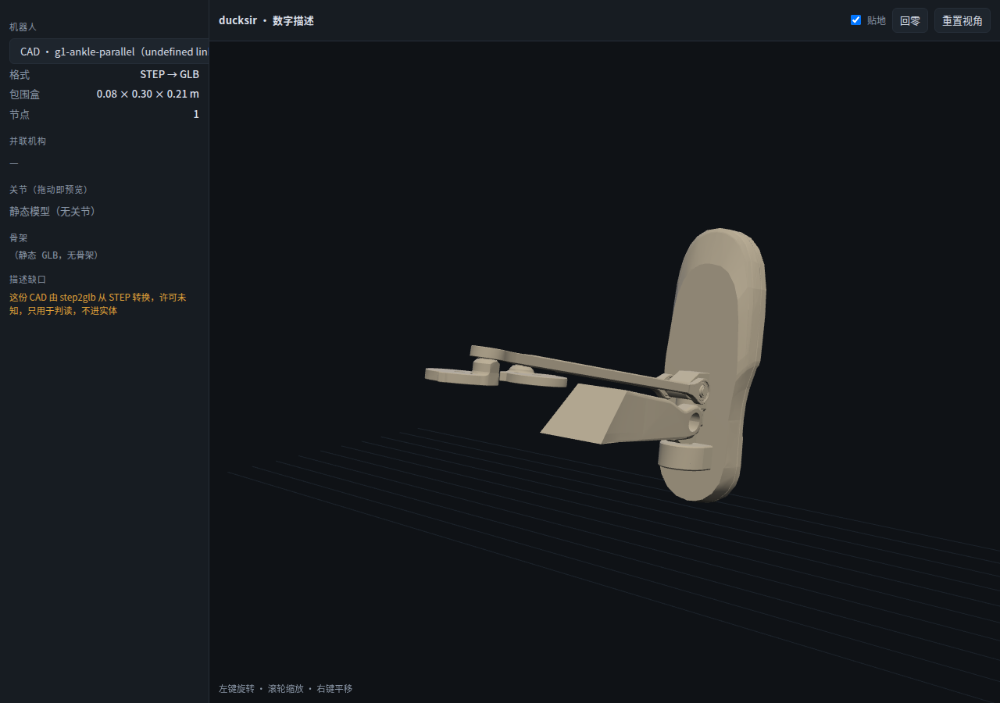
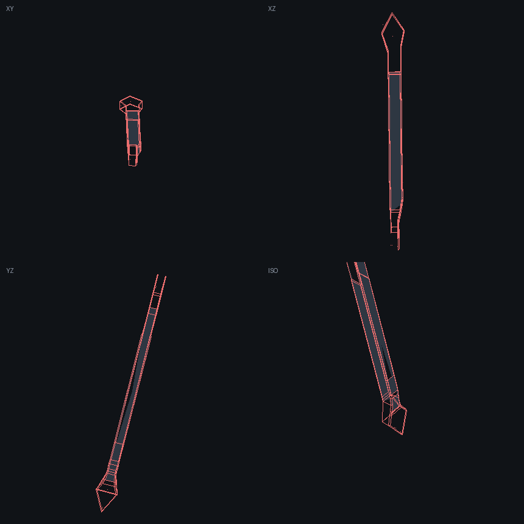
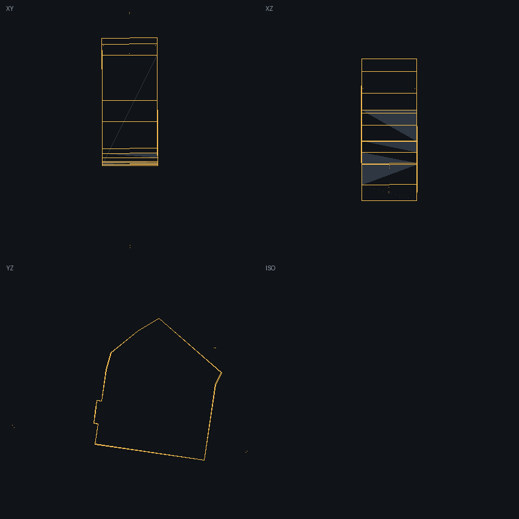
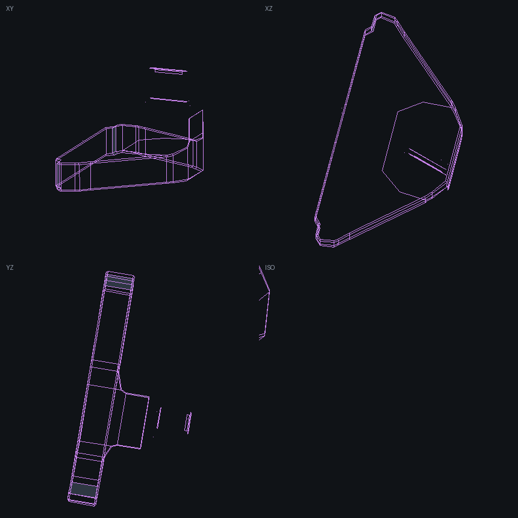
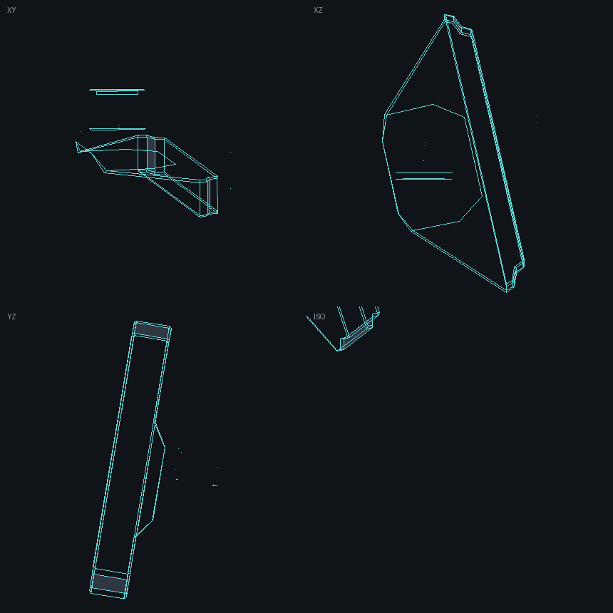
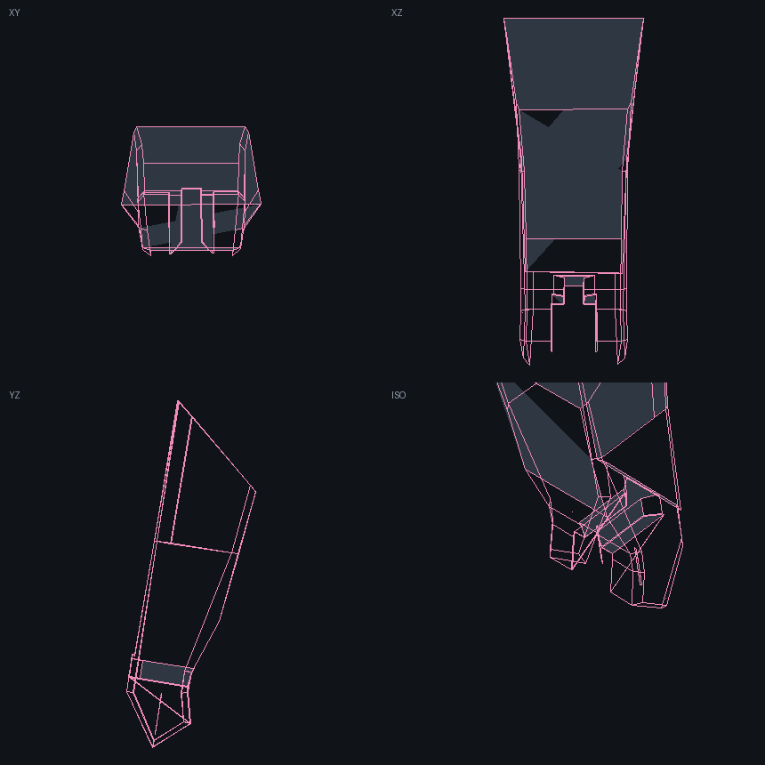
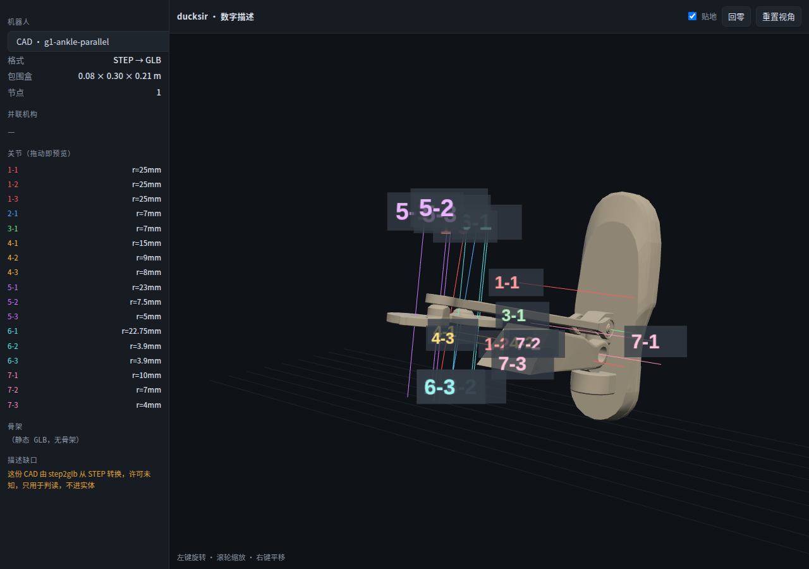
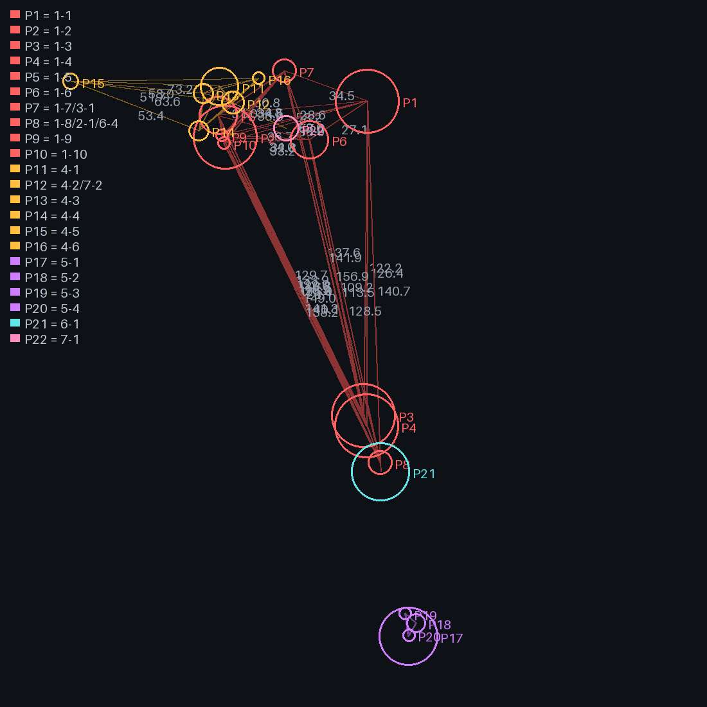
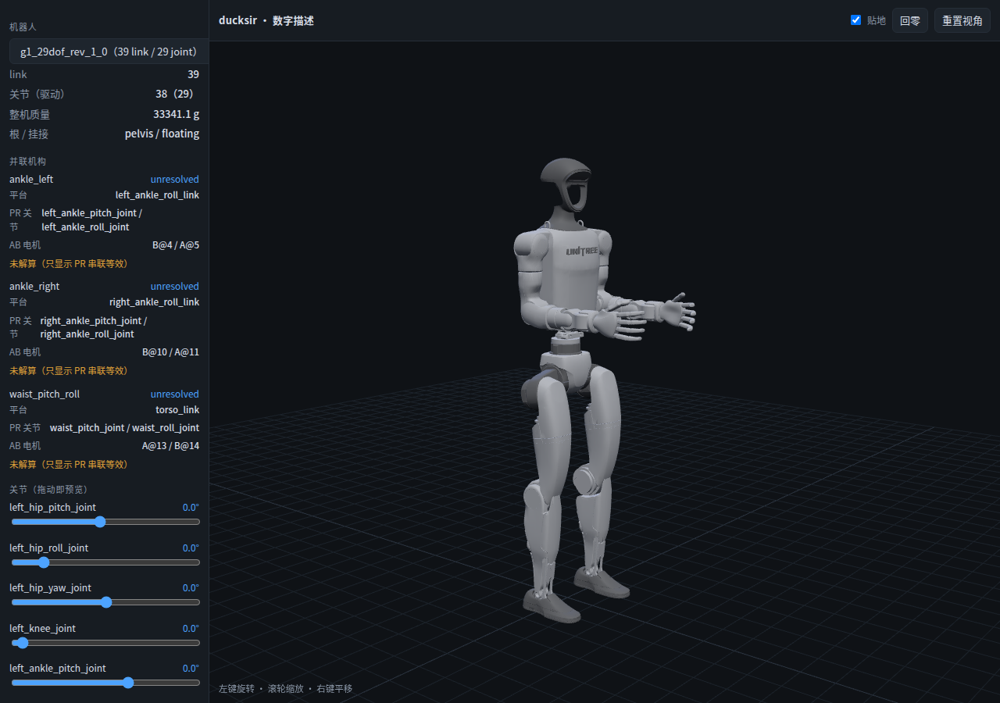

# 并联机构（AB / PR 两套坐标）

> 状态：**结构已落，映射未解**。2026-11-09 与庆喆逐条拍板（Q7–Q20）。
> 关联：[数字描述执行计划](2026-11-09-robot-entity.md)、[GLOSSARY](../../GLOSSARY.md)。

## 0. 这件事到底在解决什么

G1 的踝和腰，**实物是并联、模型是串联**：

| | 实物 | 官方模型（URDF/MJCF） | SDK |
|---|---|---|---|
| 踝（×2） | 两个电机经连杆驱动一块平台，2 自由度 | `ankle_pitch → ankle_roll` 串联链 | `mode_pr=PR/AB` 切换解释 |
| 腰（×1，29DOF） | 同上 | `waist_pitch → waist_roll` | 同上 |

所以 `mode_pr` 不是「两种机型」，而是**同一组电机在两套坐标里的两种读数**：

```
AB 坐标（电机角）  ──f──►  PR 坐标（平台角，等价于串联模型的关节角）
      ▲                              ▲
   真机、辨识                      训练、URDF、策略
```

宇树给了几何（官方文档 + CAD），没给 `f`——SDK 原文「需自行计算并联机构运动学」。

## 1. 决策

| # | 决定 | 理由 |
|---|---|---|
| Q7 | AB 与 PR **都是真的**，各标各的，中间一条显式映射 | 任选一侧，另一侧就变成口口相传的换算 |
| Q12 | **不新增 type**：同一个 `g1-29dof` 里加 `mechanisms[]` + `preset: ab` | PR/AB 是同一台机器的两套坐标；新 type 会让每个模式复制一台机器 |
| Q13 | 先落**拓扑**，`coupling.kind: unresolved`；几何量测单列一步 | 官方 CAD 无装配树、无零件名，量测要人判读 |
| Q14 | 仿真/验证用 **MuJoCo**；Newton 只记一笔 | 本机无 NVIDIA GPU（Intel Arrow Lake 核显），Newton 要 CUDA；且只有 SolverMuJoCo 完整执行 equality，还忽略闭环关节的驱动与限位；mjlab 仍是训练栈 |
| Q15 | 验收先用「能加载、能跑 5 s 不发散」，误差阈值等第一批数据按 3σ 定（量级参考：位置 ≤1 mm、姿态 ≤0.2°） | 几何本身没核实，先定死阈值等于给假精度 |
| Q16 | 客户端**不写通用约束求解器**，将来写「这一种 2-DOF 连杆的闭式解」 | 通用求解器在浏览器里是负担，第二个机构还不存在 |
| Q17 | 官方 CAD **不入库**，只记 URL + sha256 | 宇树产品的结构件 CAD，没有明确再分发条款 |
| Q18 | 映射**自己写**，MuJoCo 建并联模型做对照（两条独立路径互验） | Newton 不提供 AB→PR 的函数，它解的是动力学 |
| Q20 | CAD 判读现在做，产出「疑似零件 → 尺寸」清单给人确认 | 没确认的数不进 canonical |

## 2. 硬事实（可复核）

- 官方文档：<https://support.unitree.com/home/zh/G1_developer/basic_motion_routine>（「G1 踝关节采用并联机构」；PR 对应 URDF；AB 需自行计算）
- 索引表：<https://github.com/unitreerobotics/unitree_mujoco/blob/main/unitree_robots/g1/g1_joint_index_dds.md>
  29DOF：`4=L_ANKLE_PITCH/B`、`5=L_ANKLE_ROLL/A`、`10=R_ANKLE_PITCH/B`、`11=R_ANKLE_ROLL/A`、`13=WAIST_ROLL/A`、`14=WAIST_PITCH/B`
  → **规律：A ↔ roll，B ↔ pitch**。AB 模式不是多出电机，是同一槽位换解释。
- 两个官方仓库（unitree_ros / unitree_mujoco）0 处 `<equality>`；社区 feidedao 那份并联踝模型作者自标「动力学不可信」，只能当几何参考。
- MJCF 里表达闭环只有两种可用写法：`<connect>`（Cassie 踝、Robotiq 2F85 都用它）与 joint equality（Robotiq 还有）；SDF 的 `must_be_loop_joint` 是 Simbody 专用开关，**不是**通用闭环机制。
- Newton v1.7.0：读 MJCF 默认 `convert_mjc_equality_constraints=True`，CONNECT → BALL 闭环关节；但显式 equality 只有 `SolverMuJoCo` 后端执行，且**闭环关节的驱动与限位被忽略**。

## 3. 官方 CAD 判读：能认出连杆了

没有 CAD 软件也能认零件：STEP 是文本，**B-rep 里的 `CYLINDRICAL_SURFACE` 自带轴线位置、方向、半径**，
棱线来自 `EDGE_CURVE`，平面片来自 `EDGE_LOOP`。两个脚本就是干这个的：

```bash
python3 tools/cad/step_analyze.py "<G1脚踝并联结构.stp>" --out /tmp/cadout   # 尺寸 + 圆柱清点 + 平行孔对
python3 tools/cad/step_render.py  "<G1脚踝并联结构.stp>" --out /tmp/cadout   # 三视图 + 等轴测（线框 + 平面填充）
```

### 3.0 先更正一个数：这不是整台机器人，是**踝 + 脚**

我最早手搓解析给的是 852 × 192 × 149 mm、Y 跨 5.6 m——**错了**。那是把 B-spline 的
**控制点**也算进了包围盒。用 OpenCascade（`step2glb`）读出来是：

```
包围盒 0.08 × 0.30 × 0.21 m（80 × 300 × 210 mm）· 45,463 三角面 · 11 个节点
```

所以这份 `G1脚踝并联结构.stp` 是**单只脚踝的局部件**，不是人形整机。
整台 G1 是 39 个 link、约 1.3 m 高——那在另一个文件里。



（右：脚板/踝平台；左：两根连杆与电机座。用 `step2glb` 转成 GLB 后在查看器的「CAD · g1-ankle-parallel」里看。）

### 3.1 清单（7 个实体）

| # | 尺寸 dx,dy,dz (mm) | 平面/圆柱/锥面 | 关键几何 | 判读 |
|---|---|---|---|---|
| 1 | 66.4 × 82.0 × **199.3** | 25 / 15 / 18 | 两个 r=25 凸台（相距 59 mm）；**平行孔对中心距 147.6 mm**（r 15/9.5） | **连杆/推杆**（细长、两端眼） |
| 2 | 14.0 × 6.3 × 11.1 | 2 / 3 / 0 | r=7 圆柱（Ø14） | 销/轴 |
| 3 | 4.2 × 9.0 × 13.9 | 2 / 3 / 0 | r=7 圆柱 | 销/轴 |
| 4 | **119.1 × 120.7** × 39.7 | 10 / 10 / 4 | r=15 @x=-209、r=9 @x=-108；平行孔对 31.0 mm | **平台/脚板**（扁平，带轴承孔） |
| 5 | 29.4 × 75.8 × 52.7 | 14 / 24 / 36 | r=23 / 21.5 同轴凸台，轴 (−0,0.99,−0.17) | 电机壳/法兰 |
| 6 | 28.2 × 24.7 × 42.2 | 12 / 11 / 16 | r=22.8 / 18.8 同轴，轴同上 | 电机座/支臂 |
| 7 | 149.0 × 192.3 × **852.5** | 19 / 6 / 8 | 底部 clevis，r=10 / r=7 孔 | 小腿壳（带叉口） |











### 3.2 三个已经能定的

1. **连杆是实体 1**：细长杆、两端有眼，两孔中心距 **147.6 mm**、孔半径 15 / 9.5 mm——这个数就是 `f` 里的连杆长度。
2. **平台是实体 4**：119 × 121 × 40 的扁块，带 r=15 与 r=9 的轴承孔，平行孔对 31.0 mm。
3. **全部零件在同一个装配坐标系里**（x ≈ −210…0，z ≈ −870…−520）。这一点很关键：**不需要装配树也能算相对位置**——电机轴、连杆孔、平台孔都在一个系里，可以直接量。

### 3.3 三个还不能定的

1. **第二根连杆在哪**：2-DOF 并联踝通常两根连杆/两个曲柄，文件里只认出一根细长杆。可能另一根与它同构被合并了，也可能藏在实体 5/6 的支臂里。
2. **5 与 6 谁是电机、谁是座**：两者都带 Ø45 左右的同轴凸台，尺寸不同（29×76×53 vs 28×25×42）。
3. **装配位姿**：零件位置是真的，但「哪个孔配哪个销」要人认——这一步没法从文本里猜。

### 3.4 铰点表（已自动提取）

```bash
python3 tools/cad/hinges.py "<x.stp>" --out /tmp/cadout   # → hinges.md / hinges.json
```

它把同一条轴线上的圆柱面合并成一个铰，再跨零件配对共轴孔（同一根销穿过两个零件）。
输出见 [docs/cad/hinges.md](../cad/hinges.md)。已经能读出来的：

| 实体 | 主要轴线 | 中心距 |
|---|---|---|
| 1（连杆块） | 两组互相垂直的 Ø50 孔（r=25），每组两孔 57.0 / 59.7 mm | 垂直方向相距 122–126 mm |
| 4（平台/脚板） | r=15 与 r=9 两孔，间距 **101 mm**；另有 r=8 / 6.5 / 5 小孔 | 90° 方向 53–63 mm |
| 2、3（销） | 单轴 r=7（Ø14） | — |

这些数直接就是 `f` 的输入：曲柄长、连杆长、平台孔距。

### 3.5 轴号图（用来定机构拓扑）

```bash
python3 tools/cad/axis_map.py "<x.stp>" --out /tmp/cadout    # 出 axes-iso/xz/xy.png + axes.md
```

查看器里也直接画了：下拉选「CAD · g1-ankle-parallel」，侧栏列出全部轴号（`实体-序号`），
3D 里每条轴画成同色线段 + 标签。**可以自由转着看，确认哪根是哪根。**



候选判读（待你确认）：

| 轴 | 半径 | 我的猜测 | 依据 |
|---|---|---|---|
| `5-1` / `6-1` | 23.0 / 22.75 mm | **两个电机的输出轴** | Ø46 量级正是电机壳/法兰，两轴平行、间距 65.0 mm |
| `4-1` / `4-2` | 15 / 9 mm | **平台的 pitch / roll 轴承** | 同一零件、两孔间距 101 mm，配 15/9 两种销径 |
| `1-1` / `1-2` | 25 mm | 连杆块上的一组孔（57 mm 间距） | 与另一组孔互相垂直 |
| `1-3` | 25 mm | 连杆块另一组孔 | 方向与前一组差 90° |
| `2-1` / `3-1` | 7 mm | 两根 Ø14 销 | 单独零件、单轴 |

### 3.6 销表：谁和谁共用一根销（几何判据，不靠眼睛）

```bash
python3 tools/cad/mechanism.py "<x.stp>" --out /tmp/cadout   # → mechanism.md / mechanism.png
```

判据：两孔轴线**垂距 ≤ 1 mm 且夹角 ≤ 5°** → 同一根销。结果（[docs/cad/mechanism.md](../cad/mechanism.md)）里
跨零件的只有三根：

| 销 | 穿过 | 半径 | 位置 (mm) |
|---|---|---|---|
| **P7** | 连杆 1 + 销 3 | 9.5 / 7.0 | (-127.4, 19.1, -770.3) |
| **P8** | 连杆 1 + 销 2 + 电机座 6 | 9.5 / 7.0 / 3.0 | (-131.7, 56.4, -617.9) |
| **P12** | 平台 4 + 小腿 7 | 9.0 / 7.0 | (-104.4, -1.1, -757.4) |

由此能确定：**连杆 1 的两根销相距 156.9 mm**（P7–P8 的中心距），这是 `f` 里最关键的连杆长度；
两个电机轴的间距 65.0 mm；平台与小腿通过 P12 相连。



**但到此为止了。** 再往下（哪个电机驱动哪根曲柄、曲柄半径多少）只能靠实物或官方装配图判定——
从几何里猜就是编。所以并联这条线停在「结构已表达、几何已量出、映射待标定」，`coupling` 保持 `unresolved`。

### 3.8 解算与对拍（2026-11-10 落地）

代码：`tools/parallel/solver.py`（通用 2-DOF 并联解算）、`tools/parallel/compare.py`（与 MuJoCo 对拍）。
机型：`contract/robot/types/ankle-rig-tg10.yaml`、`ankle-rig-g1.yaml`（从讲者的 XML 导入，含 `loops[]`）。

**解算怎么写的（不搬他的代码，只借三条思路）**

| 环节 | 做法 | 关键点 |
|---|---|---|
| 逆解 `ik` | 两点距离不变 → `αcosθ + βsinθ = k`，闭式取根 | 两根链各自独立，无需求解 2×2 |
| 雅可比 `jac` | 隐函数求导：`dθ/dx = -(∂g/∂θ)⁻¹(∂g/∂x)` | **天然包含 roll 轴偏置项**，正是 refs 里漏 `h0` 的根源 |
| 正解 `fw` | 牛顿迭代，残差用**平方形式** `|b-c|²-L²` | 残差形式必须和雅可比的推导一致，否则步长被放大 `2L` 倍、直接震荡 |

几何全部从实体里读（links 的变换、joints 的 axis/pos、loops 的 anchor），换机型只换 YAML。

**对拍结果**（[docs/parallel/README.md](../parallel/README.md)）

| 机型 | pitch 最大误差 | roll 最大误差 | 判定 |
|---|---|---|---|
| tg10 | 5.57e-06 rad | 6.31e-05 rad | **PASS** |
| g1 | 2.38e-03 rad | 8.57e-04 rad | FAIL |

自检两项都过：杆长守恒 2.8e-17 m、雅可比 vs 中心差分 5e-9 / 5e-8。

**g1 为什么没过 —— 是 MuJoCo 的软约束，不是我们的数学**

- 在 MuJoCo 自己的真值位形上量杆长，`g1` 违反 **70.6 µm**，`tg10` 只违反 **2.85 µm**；
- 70.6 µm ÷ 1e-4 rad ≈ 0.7 m 的量级不合理，但按杠杆换算：`g1` 的 `∂L/∂x` 只有 ~0.12 m/rad，
  70.6 µm 正好对应 **5.9e-4 rad**，与实测 6.0e-4 吻合；
- 扫频实验（0.6 / 0.06 / 0.006 Hz）误差几乎不动（6.06e-4 → 5.95e-4 rad），证明**不是动力学滞后**，是稳态的几何差。

结论：`equality/connect` 在 MuJoCo 里是弹簧。要拿 1e-4 rad 的口径验收，参照系必须是
「刚性约束求解器」，不能是 MuJoCo 的软约束；MuJoCo 适合当**第二条独立实现的近似参照**。

**开发中撞到的三个 bug（都写进代码注释）**

1. **配对不能按下标**：`<connect body1=motor_link body2=connect_link>` 才是真配对；按下标配会把左电机接到右平台，
   症状是两根杆长不等（231.7 / 164.6 mm），修好后是整数 140 / 215 mm。
2. **hinge 绕的是 `joint pos` 处的轴**：漏了 `T(pos)·R·T(-pos)`，tg10 上出现 22 mm 系统偏差（G1 的 pos 恰好为 0，掩盖了它）。
3. **牛顿残差要对齐雅可比的形式**：用「杆长差」配「平方约束的雅可比」，步长被放大 2L 倍，80 次迭代全不收敛。


### 3.9 下一步（几何 → `f`）

零件身份一确认，就能提「铰点表」：每个圆柱面 → (轴点, 轴向, 半径) → 按配对关系连成机构 →
量出曲柄长、连杆长、平台两孔距 → 写 2-DOF 平面并联的闭式解。这些数全部来自同一个坐标系，
不需要重新建模。

## 4. 已落地

| 文件 | 内容 |
|---|---|
| `contract/robot/specs/g1-parallel.yaml` | 手写机构块：3 个机制（左踝/右踝/腰）、PR 关节、AB 电机 index、`coupling: unresolved`、CAD 来源 |
| `contract/robot/types/g1-29dof.yaml` | `mechanisms[]` 3 条 + `presets.ab`；来源标 `robot.mechanisms_spec` |
| `tools/robot/importer_urdf.py` | `--mechanisms <spec>` 合并机构块，并给 `W007`（机构来自手写 spec，不是 URDF） |
| `tools/robot/check_entity.py` | 新增 **C6**：PR 关节必须存在且 actuated、AB 电机恰好 A+B、index 不重复、`coupling.kind` 合法；`unresolved` 算信息不算失败 |
| `tools/cad/step_solids.py` | STEP 按实体量尺寸（上面的表由它产出） |
| `client/viewer` | 侧栏「并联机构」：平台 / PR 关节 / AB 电机 / coupling 状态；未解算就写「只显示 PR 串联等效」 |



## 5. 下一步（按顺序）

1. **判读 CAD**：你确认上表哪两根是连杆、哪个是平台；我据此量出连杆长度与铰点。
2. **写 `f`**：2-DOF 平面并联的闭式解 + 数值兜底；参数进 `mechanisms[].coupling`。
3. **建对照**：MuJoCo 里用 `equality/connect` 复现并联踝，跑 AB 网格，比平台位姿。
4. **viewer 接上**：`coupling` 有解析式后，滑条切 AB 也能动（现在只显示 PR）。
5. **限位**：AB 模式下电机行程受平台限位约束，`limit` 仍按 PR 关节定义（Newton 那条坑：闭环关节的限位会被忽略）。

## 6. 未定

- 左右踝是否镜像（映射能不能共用一份参数）。
- 腰部连杆与踝不同构，映射不能照抄。
- `presets.ab` 只是声明，contract 侧「策略吃哪张坐标表」还没定。
- CAD 里 7 个实体的颜色对应关系没解。
- Newton 何时引入：等有 NVIDIA 机器、且有「批量扫参数」的需求时再说。
